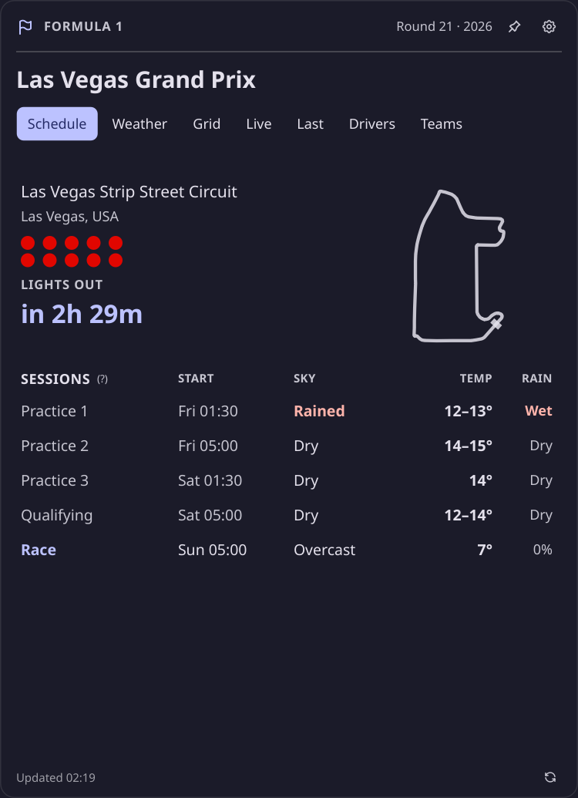
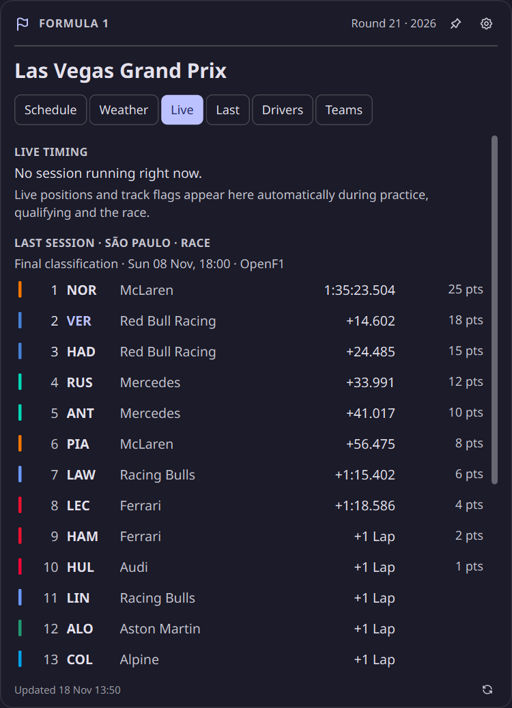
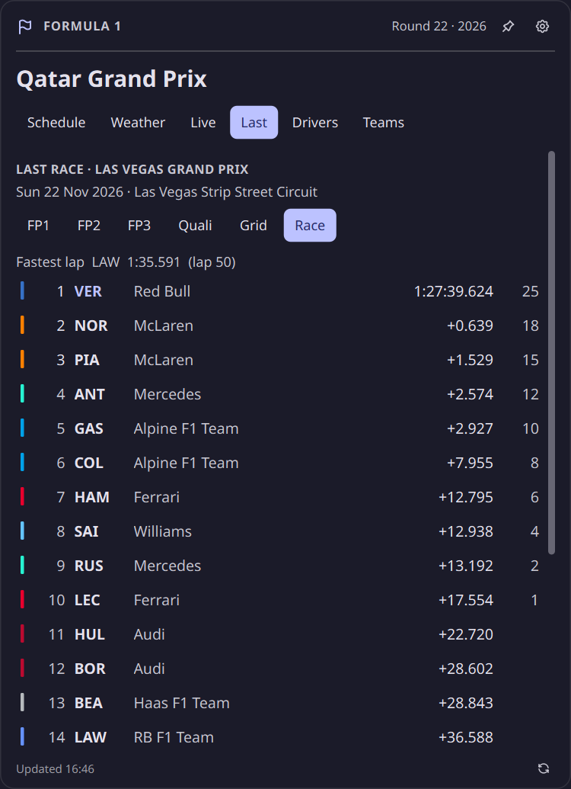
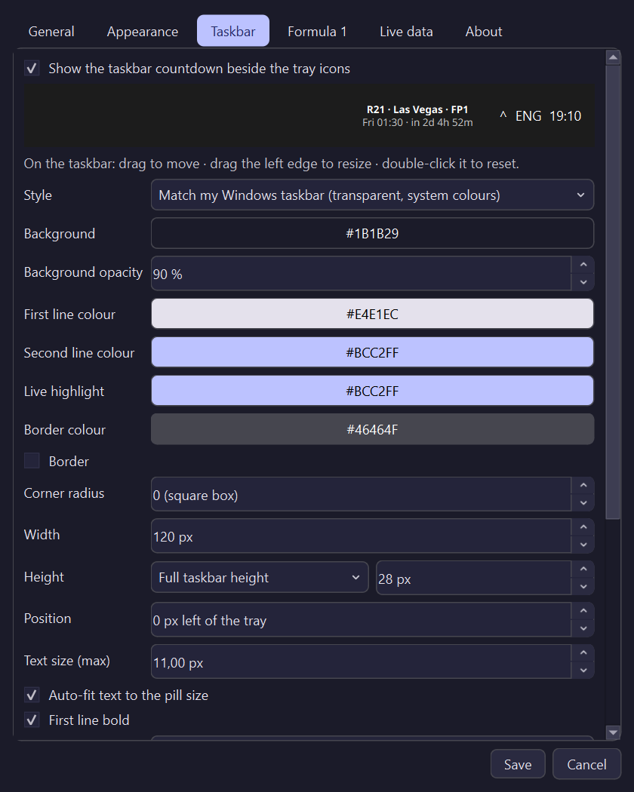

# F1DockTimers

F1 schedule, countdowns, live timing and standings for Windows 11. Inspired by, and closely
modelled on, the [Noctalia Formula 1 plugin](https://noctalia.dev/plugins/community/f1) (gcap0n1, MIT):
the same panel, the same six tabs and the same behaviour. It runs as a tray
popup, a desktop widget and a small countdown pill on the taskbar. All three can run together and
share one data cache.

## Screenshots

<p>
  
  
  
</p>
<p>
  
  
  
</p>

The taskbar countdown in three styles:


## Install and run

**Installer (recommended):** download `F1DockTimers-<version>-setup.exe` from Releases and run it. It installs
per user (no admin rights), adds a Start menu entry, optionally starts with Windows, and includes an
uninstaller. The GitHub workflow builds it on every `v*` tag. Locally it needs Inno Setup 6
(`winget install JRSoftware.InnoSetup`).

**Portable:** download `F1DockTimers-<version>-portable.exe` and run it from anywhere. It's one file and
nothing gets installed, but it starts a couple of seconds slower because it unpacks itself on each launch.

**Updating:** the app checks GitHub once a day and shows "Update x.y.z available" in the panel, a
notification and an **Install update** entry in the tray menu. One click downloads the new version,
checks it against GitHub's published SHA-256 checksum, installs it and restarts. The installed app updates through the
installer; the portable exe replaces itself. You can turn the check off in Settings › General.

The exe isn't code-signed, so Windows SmartScreen may say "Windows protected your PC". Click
**More info → Run anyway**. You don't need Python for either download.

**From source:**

```powershell
python -m venv .venv
.venv\Scripts\pip install -r requirements.txt -r requirements-dev.txt
.venv\Scripts\pythonw launch.pyw --show
```

Command-line flags: `--show` (open the panel), `--minimized`, `--widget`, `--debug` (verbose log).
Starting a second copy doesn't start a second app; it opens the panel of the one that is running.

## Using it

| Where | Action |
| --- | --- |
| Tray icon | Left click: open/close the panel. Right click: menu (refresh, widget, taskbar countdown, click-through, settings, start with Windows, exit). Middle click: refresh. |
| Panel | `←` `→` change tabs, `R` refreshes, `Esc` closes, `Ctrl+,` opens settings. The pin icon keeps the panel open when you click elsewhere. Click a row to open its Wikipedia page. |
| Desktop widget | Drag to move, drag the edges to resize, right click for the menu, double click for the action set in settings. Its position and size are remembered per monitor. Click-through mode is turned off from the **tray** menu. |
| Taskbar countdown | Sits left of the tray icons and shows `R21 · Las Vegas · FP1` above `Fri 01:30 · in 2d 6h`. While a session runs it shows `● FP1` / `LIVE`, or `● Q2` when the live feed knows the qualifying part. Click: panel. Drag: move. Drag the left edge: resize. Double-click the left edge: automatic width. |

The tabs are Schedule, Grid (from 1 h after qualifying until the race), Live, Last, Drivers and Teams.

## Taskbar countdown

Settings › Taskbar controls:

* **Style:** Noctalia, *Match my Windows taskbar* (transparent, Windows text and accent colours), or custom colours for the background, opacity, both text lines, the live highlight and the border.
* **Shape and size:** corner radius (0 gives a square box), automatic or fixed width, height (automatic, full taskbar height, or custom), position.
* **Text:** maximum size, auto-fit, bold first line, alignment, one or two lines.
* **Content:** presets, or your own templates using `{round} {race} {race_full} {session} {session_full} {time} {date} {countdown} {countdown_short} {city} {country} {circuit} {live} {flag} {leader}`. Live sessions have their own pair of templates.

Fullscreen games and videos: every 2 s the pill checks the real window stack under itself. It hides
as soon as anything covers the taskbar there (exclusive fullscreen, borderless fullscreen, or a
fullscreen window that doesn't have focus), and comes back when the taskbar is visible again. It
never takes focus. Measured cost: about 0 % CPU when idle and about 120 MB RAM for the whole app,
most of which is the Qt runtime.

## Data and privacy

* **Jolpica-F1:** schedule (every 6 h), standings and last result (every 3 h), qualifying. Requests are paced, retried 1, 2, 4 … 15 min after a failure, and the last good data is kept.
* **F1 `SessionInfo.json`:** once a minute during a race weekend, so delayed sessions show the revised time with a `+30 min vs. published time` note. Manual corrections are under Settings › Formula 1.
* **Live data** (Settings › Live data, one choice):
  * **OpenF1 Free** (default, no account; 3 requests/s and 30/min, enforced): the Live tab shows the final classification of each finished session (practice, qualifying with each driver's Q part, sprint, race) about 20 to 30 minutes after it ends. Nothing is sent to OpenF1 during sessions, because free users get no data then.
  * **OpenF1 Free + F1 live stream (experimental):** live order, gaps and the session clock during sessions from the unofficial stream behind F1's own live timing page, plus the OpenF1 results afterwards. Undocumented, so it may stop working, and F1's terms may not allow automated use.
  * **OpenF1 Sponsor** (account; 6 requests/s and 60/min): official live running order, gaps, flags and race control every 15 s. The password goes into **Windows Credential Manager** and never into a file or a log.

Settings › General › **Export / Import settings** saves everything to a `.json` file and loads it back.
Passwords are never included, and window positions and autostart stay on each PC.

Files are kept in `%APPDATA%\F1DockTimers\settings.json` (settings) and `%LOCALAPPDATA%\F1DockTimers\`
(cache, log, notification state). Startup uses the cache, so the panel shows data straight away even
when you're offline.

## Development

```powershell
$env:QT_QPA_PLATFORM="offscreen"; .venv\Scripts\python -m pytest -q   # 56 tests
powershell -ExecutionPolicy Bypass -File build\build.ps1              # tests, exe, zip, installer
```

There is also a GitHub Actions workflow (`.github/workflows/windows-build.yml`) that builds, smoke
tests and uploads the ZIP and installer, and attaches them to a release for `v*` tags.

Project layout: `f1win/core` (pure logic: time, sessions, parsers, tracks), `f1win/services`
(network poller, cache store, OpenF1/F1 stream, credentials, notifications, autostart, Win32 helpers),
`f1win/ui` (theme, panel, tabs, popup, desktop widget, taskbar pill, settings), `tests/`, `build/`
(PyInstaller spec, Inno Setup script, build script), and `docs/SOURCE-FINDINGS.md` (what was taken
from the original plugin, with the parity checklist).

## Privacy

The app does not collect or send personal data. See [PRIVACY.md](PRIVACY.md).

## Credits

See `THIRD_PARTY_NOTICES.md`. This is an unofficial project, not associated with the Formula 1
companies.
