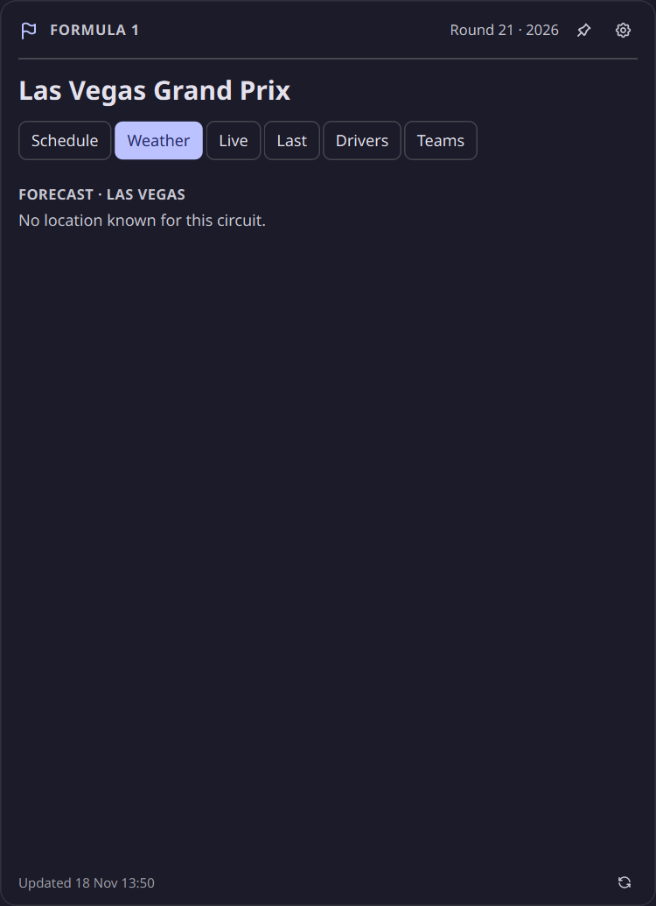
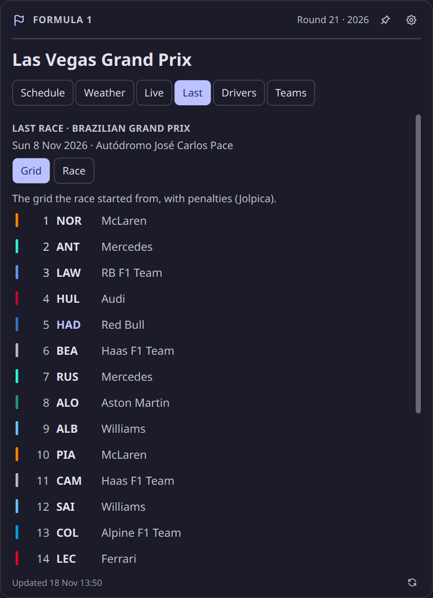
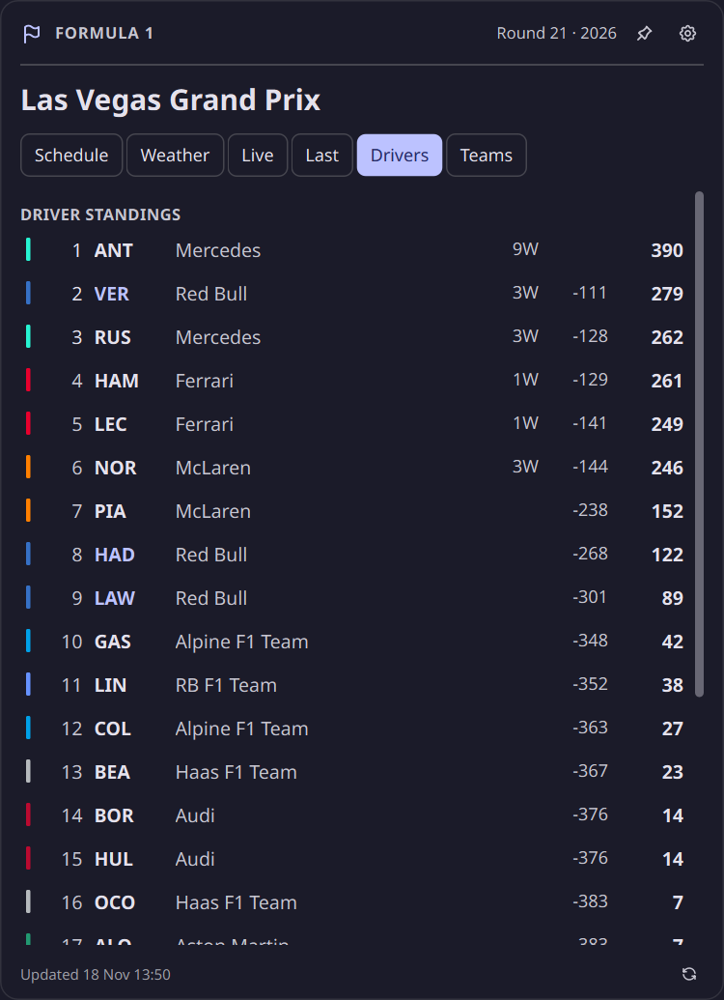
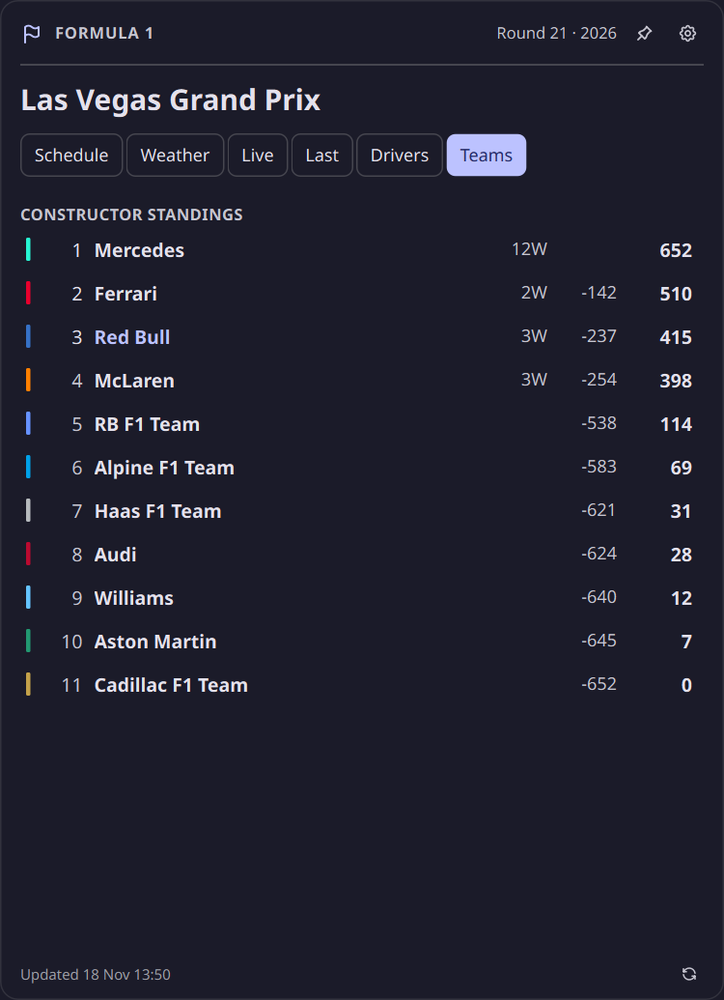
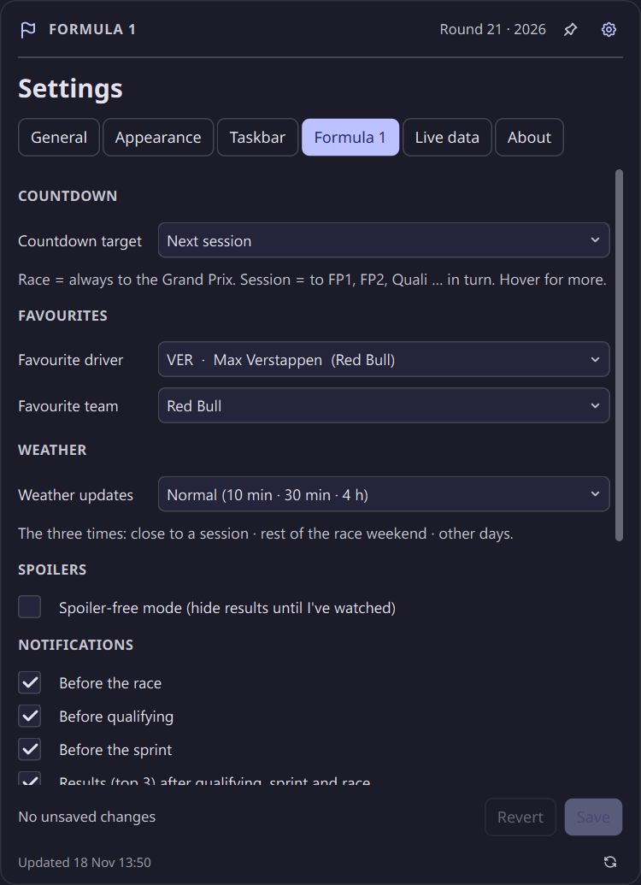
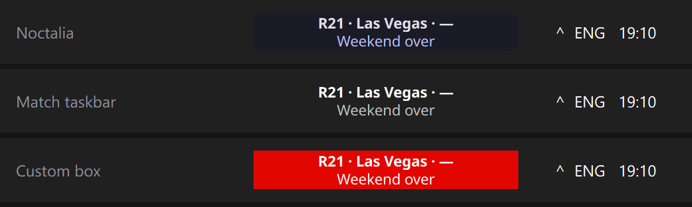

# F1DockTimers

F1 schedule, countdowns, live timing and standings for Windows 11. Inspired by, and closely
modelled on, the [Noctalia Formula 1 plugin](https://noctalia.dev/plugins/community/f1) (gcap0n1, MIT):
the same panel, the same six tabs and the same behaviour. It runs as a tray
popup, a desktop widget and a small countdown pill on the taskbar. All three can run together and
share one data cache.

Since 1.1.0 the app is written in C++ with Qt 6 (1.0.x was Python): the same look and behaviour in a
quarter of the download, about half the memory and a faster start.

## Screenshots

<p>
  
  
  
</p>
<p>
  
  
  
</p>
<p>
  
  
  
</p>

The taskbar countdown in three styles:



## Install and run

**Installer (recommended):** download `F1DockTimers-<version>-setup.exe` from Releases and run it. It installs
per user (no admin rights), adds a Start menu entry, optionally starts with Windows, and includes an
uninstaller. Installing over an older version keeps your settings; over 1.0.x it also removes the old
version's files (an option on the installer page, ticked by default).

**Portable:** download `F1DockTimers-<version>-portable.zip`, unzip it anywhere and run
`F1DockTimers.exe`. Nothing gets installed. It doesn't update itself; get new versions from Releases.

**Updating:** the app checks GitHub once a day and shows "Update x.y.z available" in the panel, a
notification and an **Install update** entry in the tray menu. One click downloads the new version,
checks it, installs it and restarts. An update is only installed if its checksum list is signed with
the F1DockTimers release key (which never leaves the maintainer's PC) and matches GitHub's own
SHA-256 for the file; otherwise the app only links to the release page. You can turn the check off in
Settings › General.

**Checking a download:** each release includes `SHA256SUMS.txt`, its signature `SHA256SUMS.txt.sig`
and a GitHub build attestation, which proves the files were built by this repository's GitHub
Actions workflow. With the GitHub CLI:
`gh attestation verify F1DockTimers-x.y.z-setup.exe --repo Kjerne/F1DockTimers`.

The exe isn't code-signed, so Windows SmartScreen may say "Windows protected your PC". Click
**More info → Run anyway**.

Command-line flags: `--show` (open the panel), `--minimized`, `--widget`, `--quit` (close the running app).
Starting a second copy doesn't start a second app; it opens the panel of the one that is running.

## Using it

| Where | Action |
| --- | --- |
| Tray icon | Left click: open/close the panel. Right click: menu (refresh, widget, taskbar countdown, click-through, settings, start with Windows, exit). Middle click: refresh. |
| Panel | `←` `→` change tabs, `R` refreshes, `Esc` closes, `Ctrl+,` (or the gear) opens the Settings tab, where changes apply when you press Save (`Ctrl+S`). The pin icon keeps the panel open when you click elsewhere. Click a row to open its Wikipedia page. |
| Desktop widget | Drag to move, drag the edges to resize, right click for the menu, double click for the action set in settings. Its position and size are remembered per monitor. Click-through mode is turned off from the **tray** menu. |
| Taskbar countdown | Sits left of the tray icons and shows `R21 · Las Vegas · FP1` above `Fri 01:30 · in 2d 6h`. While a session runs it shows `● FP1` / `LIVE`, or `● Q2` when the live feed knows the qualifying part. Click: panel. Drag: move. Drag the left edge: resize. Double-click the left edge: automatic width. |

The tabs are Schedule, Grid (from 1 h after qualifying until the race), Live, Last, Drivers and Teams.
**Live** and **Last** have a row of session pills (FP1, FP2, FP3, Quali, Race, or SQ and Sprint on a
sprint weekend): Live shows every finished session of the latest weekend, Last every session of the
last race weekend, plus its starting grid after penalties.

## Taskbar countdown

Settings › Taskbar controls:

* **Style:** Noctalia, *Match my Windows taskbar* (transparent, Windows text and accent colours), or custom colours for the background, opacity, both text lines, the live highlight and the border.
* **Shape and size:** corner radius (0 gives a square box), automatic or fixed width, height (automatic, full taskbar height, or custom), position.
* **Text:** maximum size, auto-fit, bold first line, alignment, one or two lines.
* **Content:** presets, or your own templates using `{round} {race} {race_full} {session} {session_full} {time} {date} {countdown} {countdown_short} {city} {country} {circuit} {live} {flag} {leader}`. Live sessions have their own pair of templates.

Fullscreen games and videos: every 2 s the pill checks the real window stack under itself. It hides
as soon as anything covers the taskbar there (exclusive fullscreen, borderless fullscreen, or a
fullscreen window that doesn't have focus), and comes back when the taskbar is visible again. It
never takes focus. Measured cost: about 0 % CPU when idle and a few MB of memory once idle.

**Embed in the taskbar (experimental, off by default):** the countdown becomes part of the Windows
taskbar instead of a window floating over it. It then hides together with the taskbar (fullscreen,
auto-hide), menus and flyouts always open above it, and clicking the taskbar can't cover it. If
Explorer restarts it re-attaches by itself; if the taskbar refuses it, the floating window is used.

**Spoiler-free mode** (Settings › Formula 1): watching later? Results, the grid, live timing and the
standings stay hidden from the moment a qualifying, sprint or race starts, until you press *Show
results*. Optional notifications show the top 3 after each qualifying, sprint and race.

## Translate

F1DockTimers is in English. Want it in your language?

1. **Settings › General › Language › Open language folder**: a folder opens with `_template.txt`.
2. Copy it to your language code, e.g. `de.txt`, and fill in `@code` and `@name` at the top.
3. Translate after ` = ` on each line. Empty lines stay English; keep `{placeholders}` as they are.
4. Restart, pick your language under Settings › General › Language, and check it.
5. Happy with it? Share it as a pull request into the `lang` folder so everyone gets it.

## Data and privacy

* **Jolpica-F1:** schedule (every 6 h), standings and last result (every 3 h), qualifying. Requests are paced, retried 1, 2, 4 … 15 min after a failure, and the last good data is kept.
* **Weather:** the forecast comes from [Open-Meteo](https://open-meteo.com/) (free, no account, CC BY 4.0) for the circuit's coordinates, hour by hour for every session, from about 16 days before the weekend. How often it updates is up to you (Settings › Formula 1 › Weather updates: Fast, Normal, Slow, Custom or Off). During a session the Weather tab also shows live air and track temperature, rain, humidity and wind from F1's timing feed (with the "F1 live stream" setting).
* **Official grid:** after qualifying, the Grid tab also shows the official starting grid with penalties from OpenF1, checked again 60, 20 and 5 minutes before the race.
* **F1 `SessionInfo.json`:** once a minute during a race weekend, so delayed sessions show the revised time with a `+30 min vs. published time` note. Manual corrections are under Settings › Formula 1.
* **Live data** (Settings › Live data, one choice):
  * **OpenF1 Free** (default, no account; 3 requests/s and 30/min, enforced): the Live tab shows the final classification of each finished session (practice, qualifying with each driver's Q part, sprint, race) about 20 to 30 minutes after it ends. Nothing is sent to OpenF1 during sessions, because free users get no data then.
  * **OpenF1 Free + F1 live stream (experimental):** live order, gaps and the session clock during sessions from the unofficial stream behind F1's own live timing page, plus the OpenF1 results afterwards. Undocumented, so it may stop working, and F1's terms may not allow automated use.
  * **OpenF1 Sponsor** (account; 6 requests/s and 60/min): official live running order, gaps, flags and race control every 15 s. The password goes into **Windows Credential Manager** (encrypted by Windows for your account) and never into a file or a log.

Settings › General › **Export / Import settings** saves everything to a `.json` file and loads it back.
Passwords are never included, and window positions and autostart stay on each PC.

Files are kept in `%APPDATA%\F1DockTimers\settings.json` (settings) and `%LOCALAPPDATA%\F1DockTimers\`
(cache, log, notification state). Startup uses the cache, so the panel shows data straight away even
when you're offline.

## Development

Needs Visual Studio 2022 (C++ workload) and Qt 6.8.3 for MSVC 2022 64-bit; details in
[docs/BUILD.md](docs/BUILD.md).

```powershell
cmake --workflow --preset release                                    # build and run all tests
powershell -ExecutionPolicy Bypass -File packaging\build.ps1         # + app folder, portable zip, installer
```

The GitHub Actions workflow (`.github/workflows/windows-build.yml`) builds, tests and smoke-tests the
app, and attaches the setup, the portable zip, `SHA256SUMS.txt` and a build attestation to a release.
Releasing (including signing with the release key) is described in [docs/RELEASING.md](docs/RELEASING.md).

Project layout: `src/core` (pure logic: time, sessions, parsers, weather, spoilers, update rules),
`src/services` (poller, cache store, HTTP, OpenF1 and F1 stream, credentials, notifications,
updater, autostart, Win32 helpers), `src/ui` (theme, panel, tabs, popup, desktop widget, taskbar
countdown, settings), `tests/` (Qt Test), `packaging/` (release build, Inno Setup installer, Store
assets), `tools/` (release key and signing, translation template, screenshots), and `docs/`
(`PORT_NOTES.md` on the move from Python, `SOURCE-FINDINGS.md` on what came from the original plugin).

## Privacy

The app does not collect or send personal data. See [PRIVACY.md](PRIVACY.md).

## Credits

See `THIRD_PARTY_NOTICES.md`. This is an unofficial project, not associated with the Formula 1
companies.
